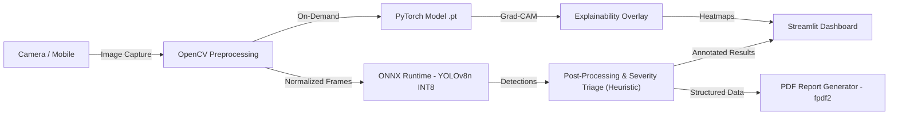
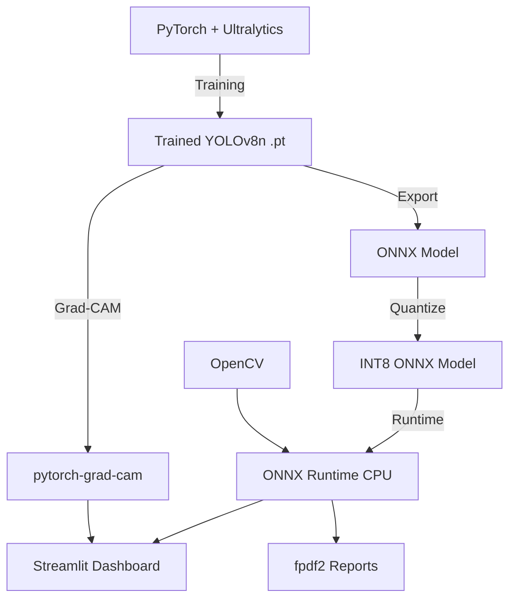

# AeroSentinel — Offline Edge-AI for Aircraft Surface Defect Detection

**Team:** Cygnus  
**Project Title:** *AeroSentinel: AI-Powered Offline Structural Vigilance for Aircraft Inspection*

## Project Summary

AeroSentinel is a fully offline, edge-native computer vision system for aircraft surface defect detection, built by Team Cygnus. It replaces cloud-dependent inspection pipelines with a local inference engine that runs on standard CPU hardware (laptop/tablet), processes frames in <30ms, and generates maintenance reports — all air-gapped. The complete PoC is designed for a 14-day build cycle across five structured phases.

**Target defects:** Corrosion, paint delamination, surface cracks, fastener anomalies.

---

## Architecture Overview

> [!NOTE]
> **Dual-model architecture:** ONNX Runtime handles all primary inference. The PyTorch `.pt` model is retained separately and loaded on-demand solely for Grad-CAM explainability, since Grad-CAM requires the PyTorch autograd graph and cannot operate on ONNX models.

---

## Implementation Plan

### Phase 1 — Data Preparation & Model Training

| Step | Task | Details |
|------|------|---------|
| 1.1 | Acquire NEU dataset | 1,800 images, 6 defect classes. Convert annotations to YOLO format (class x_center y_center w h). |
| 1.2 | Dataset split | 70/15/15 train/val/test. Stratified by class. |
| 1.3 | Augmentation pipeline | Albumentations: random brightness/contrast, perspective warp, CLAHE, horizontal flip, synthetic crack overlay. |
| 1.4 | Fine-tune YOLOv8n | Transfer learning from COCO-pretrained weights. 100–150 epochs, batch 16, img 640, SGD optimizer. |
| 1.5 | Evaluate | Target ≥85% mAP@0.5 on test set. Per-class AP breakdown. |

---

### Phase 2 — Edge Optimization & Export

| Step | Task | Details |
|------|------|---------|
| 2.1 | Export to ONNX | `model.export(format='onnx', dynamic=True, simplify=True)` |
| 2.2 | INT8 quantization | Post-training quantization via ONNX Runtime quantization toolkit. Calibration on 200 representative images. |
| 2.3 | Validate quantized model | Compare mAP drop (acceptable: ≤2%). Benchmark latency on target CPU. |
| 2.4 | Target: model <2MB, inference <30ms on i5-class CPU | |

---

### Phase 3 — Vision Pipeline

| Step | Task | Details |
|------|------|---------|
| 3.1 | Image ingestion | OpenCV: load from file, webcam, or directory batch. |
| 3.2 | Preprocessing | Resize to 640×640, normalize, CLAHE enhancement on grayscale channel. |
| 3.3 | Inference wrapper | ONNX Runtime `InferenceSession`, NMS post-processing, confidence threshold filtering. |
| 3.4 | Severity classifier | **Heuristic** rule-based triage on detection area + confidence: Low / Medium / Critical. Explicitly not a learned classifier — noted as PoC limitation. |
| 3.5 | Grad-CAM integration | Load PyTorch `.pt` model on-demand (not ONNX). Hook into last conv layer of YOLOv8n backbone via `pytorch-grad-cam`. Overlay heatmap on source image. Unloaded after use to free RAM. |

---

### Phase 4 — Dashboard & Reporting

| Step | Task | Details |
|------|------|---------|
| 4.1 | Streamlit layout | Sidebar: upload / camera toggle, confidence slider, severity filter. Main: annotated image + defect log table. |
| 4.2 | Severity heatmap | Aggregate detection locations into a spatial heatmap overlay on aircraft silhouette. |
| 4.3 | Defect log | Timestamped table: defect class, confidence, severity, bounding box coordinates. |
| 4.4 | PDF report | fpdf2: header (aircraft ID, date, inspector), annotated images, defect table, severity summary, sign-off block. |
| 4.5 | Offline-first validation | Test full pipeline with network adapter disabled. Zero external calls. |

---

### Phase 5 — Integration Testing, Demo & Packaging

| Step | Task | Details |
|------|------|---------|
| 5.1 | End-to-end test | Feed 50 unseen images → verify detections, report generation, Grad-CAM overlays. |
| 5.2 | Cross-platform test | Windows + Linux (Ubuntu). Verify ONNX Runtime CPU provider works on both. |
| 5.3 | Packaging | `requirements.txt` + setup script. PyInstaller dropped from PoC scope — unnecessary complexity for demo submission. |
| 5.4 | Documentation | README, usage guide, model card (see template below). |
| 5.5 | Demo recording | Record 90-second screen capture following the demo script (see below). |

---

## Dependency Map

---

## Challenges & Risk Register

### 🔴 Critical Risks

| Risk | Impact | Mitigation |
|------|--------|------------|
| **NEU dataset domain gap** | NEU contains flat steel samples, not curved aerospace surfaces. Model may underperform on real fuselage imagery. | Collect supplementary aerospace-domain images (even 200–300) for fine-tuning. Use heavy augmentation (perspective, lighting) to bridge gap. If no real data available, acknowledge this as a known limitation. |
| **INT8 quantization accuracy loss** | Aggressive quantization can degrade small-object detection (hairline cracks, small fasteners). | Benchmark per-class AP before/after quantization. If crack detection drops >3%, use mixed-precision (INT8 body + FP16 head). |
| **Grad-CAM incompatibility with ONNX** | Grad-CAM requires PyTorch autograd graph. Cannot run on ONNX model directly. | Maintain a parallel PyTorch model (.pt) for Grad-CAM only. Use ONNX for fast inference, PyTorch for explainability on demand. This increases memory footprint. |

### 🟡 Moderate Risks

| Risk | Impact | Mitigation |
|------|--------|------------|
| **YOLOv8n too small for fine-grained defects** | Nano model has limited capacity. May confuse corrosion with delamination at similar scales. | Start with YOLOv8n, but keep YOLOv8s as fallback (~22MB ONNX). Trade size for accuracy if needed. |
| **Streamlit cold-start latency** | Streamlit spins up a local server; first load can take 3–5 seconds on low-spec hardware. | Acceptable for MRO use case. Pre-warm model on startup. Cache with `@st.cache_resource`. |
| **CLAHE over-enhancement** | Aggressive contrast enhancement can create false texture patterns that trigger false positives. | Tune clip limit (start at 2.0) and tile grid size. Validate FP rate with/without CLAHE. |
| **PDF layout complexity** | fpdf2 is low-level; complex layouts (multi-image grids, heatmap embedding) are tedious. | Define a rigid report template. Keep layout simple and functional. |

### 🟢 Low Risks

| Risk | Impact | Mitigation |
|------|--------|------------|
| **Cross-platform ONNX Runtime issues** | Edge cases on ARM or older Windows builds. | Pin ONNX Runtime version. Test on target hardware early. |
| **Large image resolution handling** | 4K+ images from DSLR cameras may cause memory spikes. | Downscale to 640×640 at ingestion. Keep original for report embedding. |

---

## Key Technical Decisions Required

> [!IMPORTANT]
> **1. Dataset strategy** — The NEU dataset is steel-surface, not aerospace. This is the single biggest accuracy risk. Options:
> - (A) Use NEU as-is and acknowledge the domain gap as a limitation.
> - (B) Supplement with open aerospace inspection imagery (if available).
> - (C) Synthetically generate aerospace-like defect images.
>
> **Recommendation:** Option A for the competition submission, with Option C as stretch.

> [!IMPORTANT]
> **2. Grad-CAM dual-model overhead** — Running Grad-CAM requires keeping the PyTorch model in memory alongside the ONNX model. On a 4GB RAM tablet, this may be tight.
> - (A) Always load both models (higher RAM, full explainability).
> - (B) Load Grad-CAM on-demand only when user requests it.
>
> **Recommendation:** Option B.

> [!WARNING]
> **3. Severity classification** — The plan uses rule-based severity triage (area × confidence). This is not learned. For a competition, this is acceptable. For real deployment, severity should be a trained classifier head or validated against aerospace engineering standards (e.g., ASME/SAE defect grading).

---

## Timeline Estimate

| Phase | Duration | Dependency |
|-------|----------|------------|
| Phase 1 — Data & Training | 3–4 days | None |
| Phase 2 — Edge Optimization | 1–2 days | Phase 1 |
| Phase 3 — Vision Pipeline | 2–3 days | Phase 2 |
| Phase 4 — Dashboard & Reports | 2–3 days | Phase 3 |
| Phase 5 — Testing, Demo & Packaging | 2–3 days | Phase 4 |
| **Total** | **~12–15 days** | |

---

## Demo Script (90 seconds)

For the virtual PoC presentation, follow this exact sequence:

| # | Action | What judges see | Duration |
|---|--------|-----------------|----------|
| 1 | Show network adapter disabled | **Windows:** Settings → Network → show "No internet". **Linux:** run `ip link show` in terminal showing interfaces DOWN. Screenshot/terminal must be visible. | 5s |
| 2 | Launch Streamlit dashboard | Clean UI loads locally | 5s |
| 3 | Upload sample fuselage image with known defects | Image appears in main panel | 5s |
| 4 | Inference runs | Bounding boxes + severity labels drawn, <30ms counter visible | 10s |
| 5 | Walk through defect log table | Timestamped entries with class, confidence, severity | 15s |
| 6 | Toggle Grad-CAM overlay | Heatmap shows what the model "sees" | 15s |
| 7 | Show severity heatmap | Aggregate structural risk zones highlighted | 10s |
| 8 | Export PDF report → open it | Full structured report with annotated images | 15s |
| 9 | Recap: network still disabled | Reinforce zero-connectivity claim | 10s |

---

## Model Card Template

| Field | Content |
|-------|---------|
| **Model** | YOLOv8n (Nano) fine-tuned |
| **Format** | ONNX, INT8 quantized |
| **Training Data** | NEU Metal Surface Defect Dataset (1,800 images, 6 classes) |
| **Defect Classes** | Crazing, Inclusion, Patches, Pitted Surface, Rolled-in Scale, Scratches |
| **Performance** | ≥85% mAP@0.5 on test set (pre-quantization); ≤2% drop post-INT8 |
| **Intended Use** | PoC demonstration of edge-native aircraft surface inspection |
| **Out-of-Scope Uses** | Production MRO certification; real aerospace structural sign-off |
| **Known Limitations** | Trained on flat steel surfaces — domain gap to curved aerospace surfaces. Severity triage is heuristic, not a learned classifier. |
| **Hardware Requirements** | Any x86 CPU (i5-class or above); no GPU required; 4GB+ RAM |

---

## Deliverables Checklist

- [ ] Trained YOLOv8n model (.pt)
- [ ] Quantized INT8 ONNX model (<2MB)
- [ ] OpenCV preprocessing pipeline
- [ ] ONNX Runtime inference wrapper with NMS
- [ ] Severity triage module (heuristic, documented as such)
- [ ] Grad-CAM explainability module (on-demand PyTorch loading)
- [ ] Streamlit dashboard (upload, live view, defect log, heatmap)
- [ ] PDF report generator (fpdf2)
- [ ] End-to-end offline validation
- [ ] Model card
- [ ] README + usage guide
- [ ] requirements.txt + setup script
- [ ] 90-second demo recording

---

## Tech Stack Summary

| Layer | Technology | Role |
|-------|-----------|------|
| Training | PyTorch, Ultralytics YOLOv8 | Model fine-tuning |
| Augmentation | Albumentations | Training robustness |
| Export | ONNX | Framework-agnostic model format |
| Inference | ONNX Runtime (CPU) | Edge-native execution |
| Preprocessing | OpenCV | Image handling, CLAHE |
| Explainability | pytorch-grad-cam | Visual attribution |
| Dashboard | Streamlit | Local browser UI |
| Reporting | fpdf2 | Offline PDF generation |
| Metrics | scikit-learn | Precision, recall, confusion matrix |
| Utilities | NumPy, Pillow | Array/image ops |

---

## Phase 8.5 — Pivot to AWS GPU Training (Cost & Time Optimized)

**Status**: Planning
**Goal**: Leverage the approved 4 vCPU AWS quota to train YOLOv9s and YOLO11n on a `g4dn.xlarge` (T4 GPU) instance, massively accelerating training compared to the Intel Xeon CPU.

### User Review Required
> [!IMPORTANT]
> **AWS CLI is not installed locally**, so I cannot launch the instance for you. Please launch the instance manually using the AWS Console to ensure we don't accidentally leave infrastructure running and incur high costs.

### Open Questions
> [!WARNING]
> Please follow these exact steps to launch the instance and provide the connection details.
> 1. Go to the **AWS EC2 Console** -> **Launch Instance**.
> 2. **Name**: `AeroSentinel-Training`
> 3. **AMI**: Select **Ubuntu 22.04 LTS** (or a PyTorch Deep Learning AMI if you prefer).
> 4. **Instance Type**: Select **`g4dn.xlarge`** (This exactly uses your 4 vCPU quota and provides a 16GB Tesla T4 GPU).
> 5. **Key Pair**: Create a new key pair (e.g., `aws-key.pem`), download it, and note the path.
> 6. **Network Settings**: Ensure **Allow SSH traffic** is checked.
> 7. **Storage**: Increase the Root volume to **50 GB** (gp3).
> 8. **Launch** the instance.
> 
> **Once it is running, please reply with:**
> 1. The **Public IPv4 address** of the instance.
> 2. The local **path to your downloaded `.pem` key**.

### Proposed Changes
#### [NEW] AWS SSH Configuration
- Configure SSH locally to connect to the new AWS instance seamlessly.
- Transfer `dataset_processed.zip` (which I have already prepared locally).
- Run `train_yolov9s.py` and `train_yolo11n.py` sequentially.

### Verification Plan
#### Manual Verification
- Train times should drop from ~1+ hours per epoch (on CPU) to ~2-3 minutes per epoch (on T4 GPU).
- We will monitor the AWS dashboard to ensure we **terminate the instance immediately** after training finishes to minimize usage costs (approx $0.52/hour).
